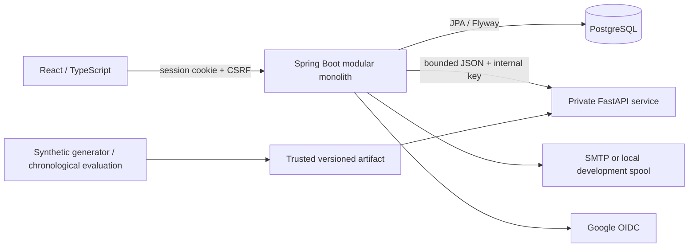

# Architecture and financial semantics

The Java modules are `auth`, `finance`, `forecast`, `scenario`, `data`, and `common`. Persistence entities are internal; controllers expose explicit records/DTOs. PostgreSQL constraints complement application validation. Flyway is the sole schema authority; Hibernate validates.

## Financial truth

Money is positive `NUMERIC(16,2)` / `BigDecimal`; type supplies the sign. API inputs allow up to 12 integral and two fractional digits. Balance arithmetic never uses floating point. Python estimates are rounded to two decimal places by Java before use; frontend numbers are presentation only.

The opening balance is cash at **the beginning of the opening date**. Current cash adds all `RECEIVED` inflows and subtracts all `PAID` outflows from that date through today in the business timezone. Dates are ISO calendar dates. Future settled records are rejected. Negative opening/projected balances are valid; negative reserves and nonpositive flow amounts are invalid.

Forecasts start tomorrow and run for 30 calendar days:

`closing[t] = closing[t-1] + estimatedUnplanned[t] + scheduledInflows[t] - scheduledOutflows[t]`

Only future `PLANNED` entries become scheduled events. Cancelled and settled entries never reappear as scheduled events. Overdue planned entries are explicitly excluded and counted in limitations; users must settle or reschedule them.

`source=SCHEDULED` means the actual originated from a known commitment. `source=UNPLANNED` is allowed only for settled records. Only the latter contributes to model history. This explicit provenance prevents scheduled amounts also becoming prediction targets. Users must classify records honestly and completely.

Missing historical days are treated as zero, from the later of opening date or 365 days ago. The UI and API disclose this completeness assumption. A long date span does not prove good data quality.

Reserve breach means **strictly below** the saved reserve. At the reserve is not a breach. Minimum-date ties use the earliest date. No breach returns `null`. No confidence percentages or uncertainty intervals are invented.

## Recurrence

Weekly/monthly occurrences are virtual and deterministic. Monthly dates always advance from the original anchor: January 31 → February 28/29 → March 31. Start/end dates are inclusive; inactive rules emit nothing.

To settle, reschedule, or cancel an occurrence, create a cash-flow entry with `recurringRuleId` and the **original** `occurrenceDate`. The DB's unique `(recurring_rule_id, occurrence_date)` key prevents duplicate replacements. The linked entry replaces that virtual occurrence regardless of status, including cancellation. A composite foreign key guarantees that the linked rule belongs to the same business.

Deleting a replacement entry restores the virtual occurrence if its rule is active. Deactivating a rule stops future virtual occurrences but retains separately recorded entries. After any occurrence has been recorded, anchor/frequency/direction changes are rejected; deactivate and create a new rule instead. Amount/description edits apply to future virtual occurrences, while explicit recorded entries keep their own values.

## Forecasts and scenarios

A forecast snapshots its starting balance, reserve, input revision, dated scheduled events, prediction provenance, limitations, and 30 points. Its generation runs under a repeatable-read database transaction. Record mutations increment the business revision; old snapshots are marked stale. A new business day also makes a prior snapshot stale.

Replay stores changes separately from financial records. A scenario is pinned to a forecast owned by the same business, enforced by a composite foreign key. Every referenced event must exist in that snapshot. Recurrence events use the deterministic string `<rule UUID>:<date>`.

Changes apply in saved order to a copied event map:

- `RESCHEDULE`: move the date.
- `AMOUNT_CHANGE`: replace the entire positive magnitude, preserving direction.
- `ADD_CASH_FLOW`: add a hypothetical inflow/outflow.
- `REMOVE_CASH_FLOW`: exclude a snapshot event.

Dates can extend up to one year from the baseline start; movements beyond the horizon have no effect inside the 30-day calculation. The same estimates and starting balance are reused. Original cash-flow, recurrence, and forecast records are never modified. Simulation is deterministic for the same snapshot and changes. Comparisons warn when a newer baseline exists or source records have changed.

## Failure behavior

Python receives only daily historical unplanned net values and forecast parameters, never application/database credentials or unrestricted access to PostgreSQL. Internal requests use an environment-provided key, 2-second connection and 3-second read timeouts. Java validates exactly 30 ordered dates and finite bounded amounts. Unavailable/invalid inference uses a named local weekday baseline, or zeros for insufficient history. These limitations are persisted with the forecast.

No state-changing browser request is automatically retried. Validation failures do not produce fake success or substitute demo records.
